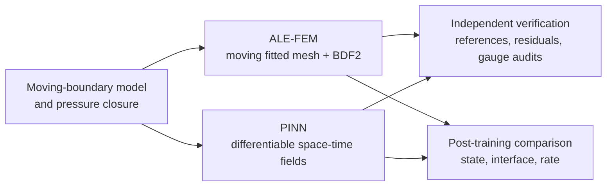
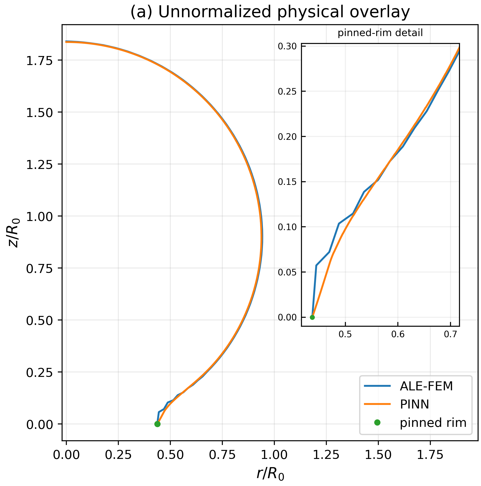
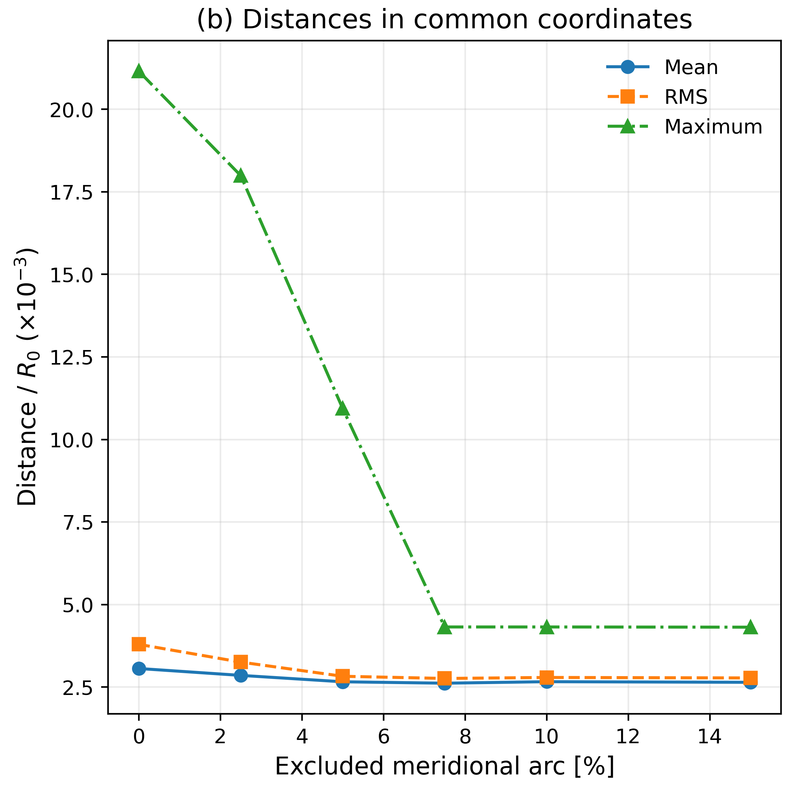
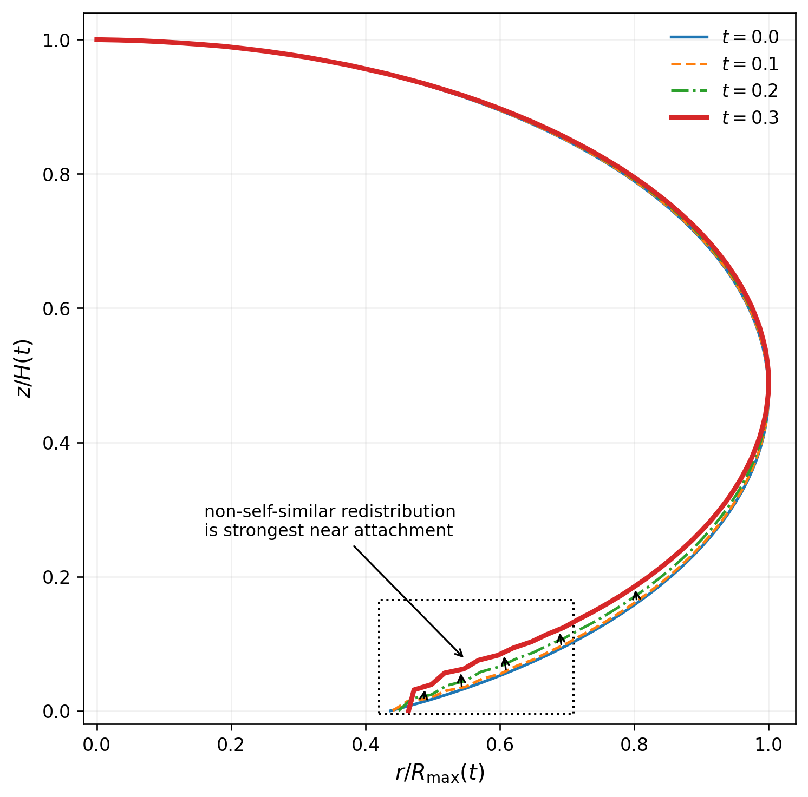
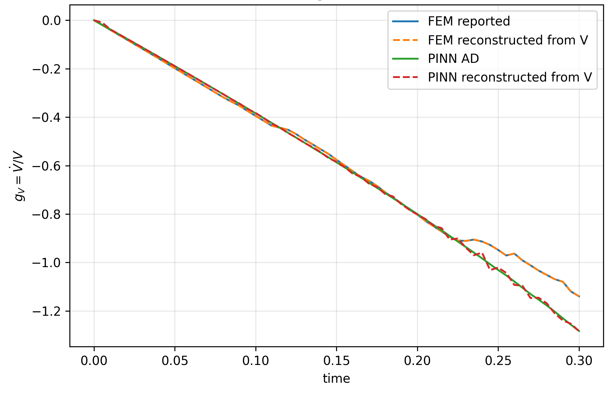

# Pressure-Driven Deformation of a Fiber-Attached Vapor Bubble

<p align="center">
  <strong>A reproducible ALE-FEM and physics-informed neural-network study of a moving, pinned vapor-liquid interface</strong>
</p>

<p align="center">
  
  
  
  
</p>

This repository contains the code, numerical exports, verification tools, and plotting workflows accompanying the study **“Pressure-driven deformation of a fiber-attached vapor bubble with a volume-based pressure closure.”**

The project compares two independent approximations of the same axisymmetric moving-boundary problem:

- an interface-fitted **arbitrary Lagrangian-Eulerian finite-element method (ALE-FEM)**;
- a **physics-informed neural network (PINN)** trained from the governing equations, boundary conditions, and integral constraints - without ALE-FEM solution data.

The central result is deliberately two-sided: the methods closely agree on accumulated bubble geometry, while their late-time compression rates agree less strongly. The largest geometric discrepancy is concentrated near the pinned fiber attachment.

## Physical model

A closed vapor bubble is pinned to a cylindrical fiber and compressed by the surrounding liquid. The model is axisymmetric and swirl-free in cylindrical coordinates $(r,z)$. The liquid is incompressible; the vapor has a spatially uniform density determined by its instantaneous geometric volume.

The total vapor pressure is decomposed as

```math
p_v^{\mathrm{tot}}(r,z,t)=P_v(t)+\rho_v(t)q_v(r,z,t),
```

where the thermodynamic part follows the volume law

```math
P_v(t)=(\Pi-1)\left(\frac{V_{v0}}{V_v(t)}\right)^\gamma-\Pi,
\qquad
\rho_v(t)=\beta\frac{V_{v0}}{V_v(t)}.
```

The dynamic pressure potential is fixed by a zero-volume-mean gauge:

```math
\left\langle q_v\right\rangle_v(t)
=\frac{1}{V_v(t)}\int_{\Omega_v(t)}q_v\,dV=0.
```

This closure identifies $P_v(V_v)$ with the volume mean of the total vapor pressure. It is a modeling assumption shared by both solvers, not a claim of uniqueness or experimental calibration.

## Two independent numerical routes



### ALE-FEM

The finite-element solver uses joined, interface-fitted liquid and vapor meshes. Velocity is represented on a common conforming quadratic space, phase pressures use separate linear spaces, and the pressure gauge is enforced algebraically in the mixed saddle-point system. Time integration uses backward Euler for startup and BDF2 thereafter, with harmonic mesh smoothing and fixed-point coupling.

### PINN

The PINN uses separate neural components for liquid kinematics, liquid pressure, vapor dynamics, and interface geometry. Its main structural ingredients are:

- an analytically divergence-free axisymmetric liquid velocity;
- moving, volume-scaled vapor coordinates centered at the geometric centroid;
- frozen Gaussian Fourier features for the vapor fields;
- a differentiable interface map with the initial shape and pinned endpoint embedded in the output;
- Chebyshev-Lobatto time nodes and a causal $0.10\rightarrow0.20\rightarrow0.30$ training curriculum;
- strong-form PDE, interface, boundary, initial, geometric, and pressure-gauge losses.

The production run uses 66,000 Adam updates across three stages. A trained checkpoint is included in [`checkpoints/`](checkpoints/).

## Cross-method results

At nondimensional time $t=0.30$:

| Observable | ALE-FEM vs PINN difference |
|---|---:|
| Normalized vapor volume | **0.70%** |
| Centroid position | **0.17%** |
| Interface RMS separation | **$3.79\times10^{-3}R_0$** |
| Interface maximum separation | **$2.12\times10^{-2}R_0$** |
| Maximum separation after excluding the first 10% of arc near the rim | **$4.32\times10^{-3}R_0$** |
| Instantaneous logarithmic volume rate | **12.57%** |

<p align="center">
  
</p>

The overlay shows close agreement over most of the interface. The inset makes the dominant local difference visible near the pinned rim.

<p align="center">
  
</p>

The cutoff audit separates the attachment-region discrepancy from the bulk-interface comparison. The sampled maximum drops sharply once the immediate rim neighborhood is excluded, whereas mean and RMS distances change only modestly.

### Shape evolution

<p align="center">
  
</p>

After separate radial and axial normalization, both methods predict a similar non-self-similar redistribution. The strongest change remains localized near the attachment.

### State agreement is stronger than rate agreement

<p align="center">
  
</p>

The methods remain close in accumulated volume even though their instantaneous rates separate after approximately $t=0.22$. This distinction is essential: sub-percent agreement in the final state does not establish full-horizon convergence of the rate.

## Verification and sensitivity evidence

The repository includes more than a single solver-to-solver comparison:

- analytical spherical reference calculations;
- a nonspherical manufactured-solution check;
- short-time ALE-FEM spatial and temporal refinement;
- a three-level PINN convergence ladder;
- fresh-point residual and pressure-mean audits;
- bidirectional point-to-polyline interface-distance diagnostics;
- capillary sensitivity for $We=1000,770,500,300$;
- outer-boundary sensitivity for radial extents $4R_0$, $5R_0$, and $6R_0$.

The baseline-to-largest-domain final-volume difference is **1.60%**, larger than the ALE-FEM-PINN difference on the baseline domain. Capillarity produces much smaller global changes in the tested range, with the strongest local response again near the pinned rim.

## Important limitations

This repository supports numerical verification of a reduced early-compression model; it is not an experimental validation package.

- The model omits heat transfer, phase change, dynamic wetting, three-dimensional asymmetry, severe collapse, jetting, and topology change.
- Full-horizon convergence through $t=0.30$ is not established; the reported refinement evidence extends only to $t=0.10$.
- The ALE compatibility correction reaches **15.94%** of the geometric rate magnitude late in the run.
- A small pressure-mean error does not imply a small continuity-compatibility defect.
- The complete forcing expressions needed for an independent manufactured-solution benchmark are not included.

## Repository map

```text
.
├── src/
│   ├── fem/                    # FreeFEM++ ALE solvers and domain variants
│   └── pinn/                   # production PINN and convergence ladder
├── notebooks_clean/           # cleaned, output-free reproducibility notebooks
├── verification/              # spherical references and operator checks
├── analysis/                  # gauge, geometry, sensitivity, and interface audits
├── figures/                   # scripts that regenerate manuscript figures
├── data/
│   ├── raw/                    # solver exports
│   └── cross_method/           # ALE-FEM/PINN comparison inputs
├── checkpoints/               # production PINN weights
├── docs/readme_assets/        # figures displayed in this README
├── requirements.txt
└── MANIFEST.tsv               # byte sizes and SHA-256 checksums
```

## Quick start

```bash
git clone https://github.com/kuznetsovks17/ALE-FEM-PINN-fiber-attached-vapor-bubble.git
cd ALE-FEM-PINN-fiber-attached-vapor-bubble

python -m venv .venv
source .venv/bin/activate
pip install -r requirements.txt
```

Open the cleaned notebooks with Jupyter, or run the exported scripts directly.

### Main PINN workflows

```bash
# Full causal training through t = 0.30
python src/pinn/train_full_horizon.py

# Three-level short-time convergence study
python src/pinn/convergence_ladder.py
```

The full training workflow is computationally expensive. Use a TensorFlow-compatible GPU for the production configuration.

### Verification and diagnostics

```bash
python verification/spherical_operator_check.py
python verification/spherical_g3_reference.py
python analysis/interface_distance_audit.py
python analysis/pinn_gauge_audit.py
python analysis/geometry_diagnostics.py
python analysis/sensitivity_analysis.py
```

### Regenerate figures

```bash
python figures/regenerate_figures.py
python figures/make_figure3.py
python figures/make_method_schematics.py
```

The figure scripts consume the committed numerical exports. They do not rerun the ALE-FEM solver or retrain the PINN.

### ALE-FEM

Install [FreeFEM++](https://freefem.org/) and run the desired `.edp` file from `src/fem/`. The baseline and stretched outer-domain variants are kept separately so that the domain-sensitivity calculations remain explicit.

## Reproducibility notes

- The PINN scripts set NumPy and TensorFlow seeds to `1234`.
- The production checkpoint is `checkpoints/production_PINN_66k.weights.h5`.
- Cleaned notebooks contain no embedded output and are intended to be executed top-to-bottom.
- `MANIFEST.tsv` records the byte size and SHA-256 hash of each publication file.
- Raw exports are committed at their original precision; display values in the article are rounded separately.

## Scope of the accompanying manuscript

The paper studies whether a pressure decomposition tied to instantaneous bubble volume is implemented consistently by two independent numerical methods. Agreement between those methods is evidence about the numerical realization of the chosen closure. It does not establish that the closure is the unique or experimentally correct description of a vapor bubble.
